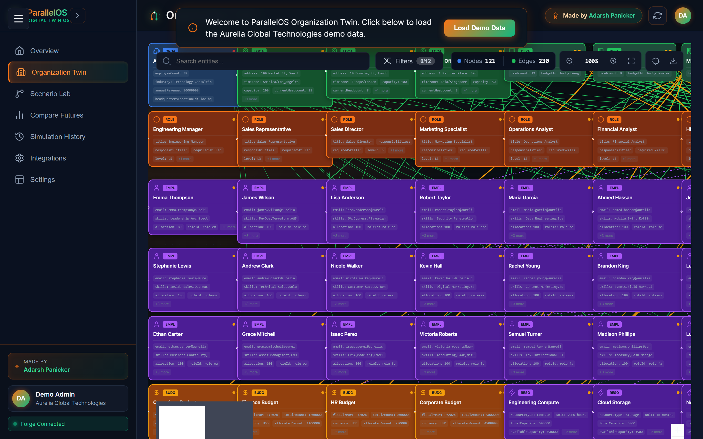
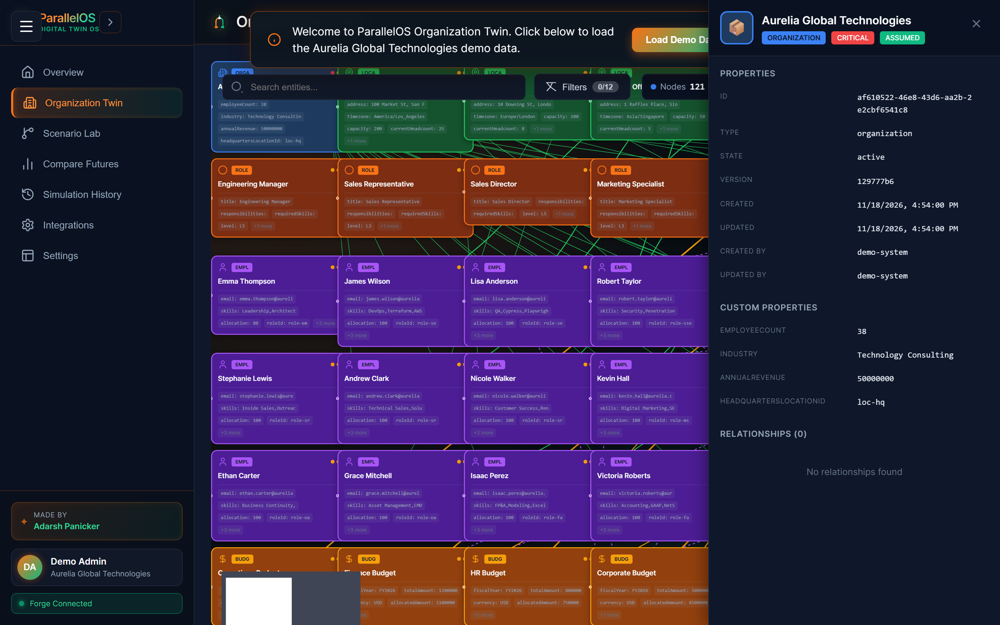
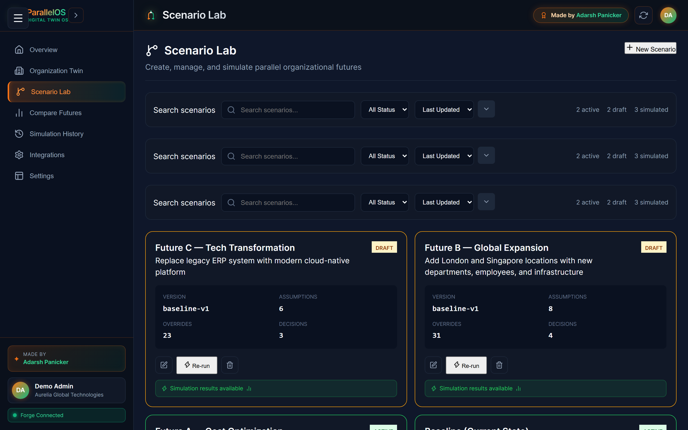
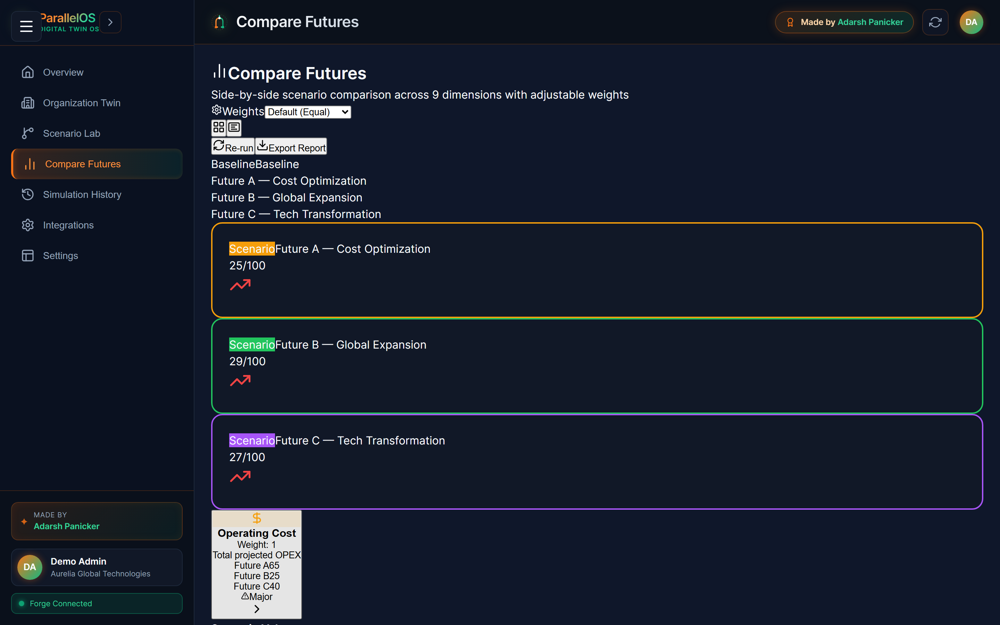
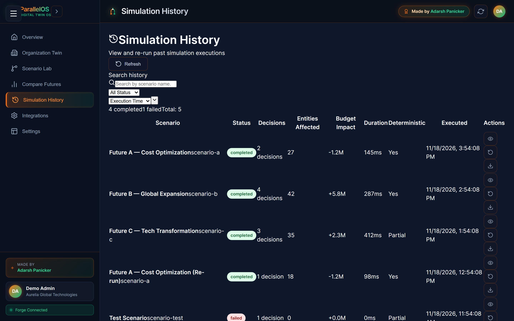
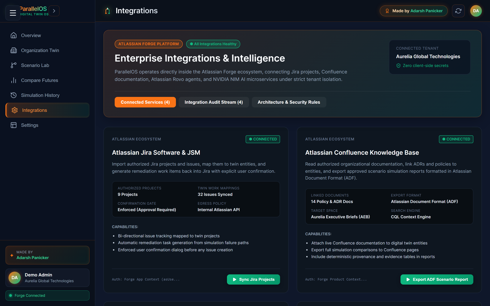
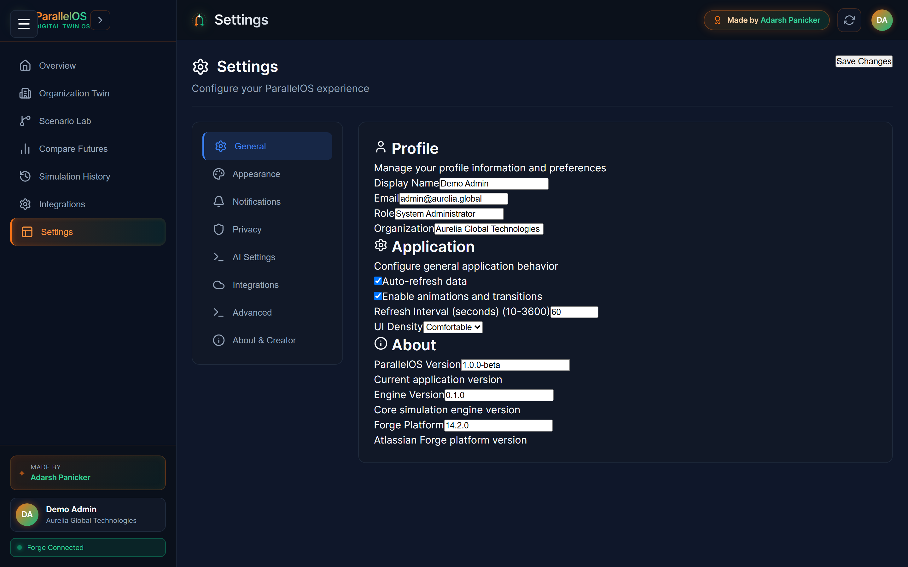

# ParallelOS

> **One Organization. Infinite Possibilities.**  
> *Enterprise Digital Twin Control Room built for Atlassian Codegeist 2026*  
> **Architected & Built by Adarsh Panicker**

[](LICENSE)
[](https://developer.atlassian.com/platform/forge/)
[](https://www.typescriptlang.org/)
[](packages/engine/tests)
[](#-visual-walkthrough--screenshots)

---

## 🌟 What Does ParallelOS Do?

**ParallelOS** is an enterprise digital twin control room built for Atlassian Cloud (Forge Custom UI). It transforms how leadership, engineering managers, and enterprise architects make strategic organizational decisions:

- **Not a Jira Dashboard, Not a Chatbot**: A high-fidelity mission control room where decision-makers view the entire organization as an active, interconnected dependency graph.
- **Branch Reality into Parallel Scenarios**: Create isolated, counterfactual future branches from your baseline organization (e.g., cutting budget, opening international offices, replacing critical software) with zero mutations to the baseline.
- **100% Deterministic Simulation**: Built in pure TypeScript with zero AI hallucinations. Ripple effects—from project delays to cascading system outages—propagate through graph dependencies with cycle safety and redundancy awareness.
- **Comparative Multi-Dimensional Scorecards**: Compare scenarios side-by-side across 9 enterprise dimensions with customizable priority weights.
- **Grounded AI Explanations**: Uses NVIDIA NIM solely to translate plain English into structured decision proposals and explain differences using verified simulation data with complete mathematical provenance.
- **Turn Decisions into Real Jira Work**: Bridge approved scenarios directly back into the enterprise by creating linked Jira remediation tasks with strict confirmation approval gates.

---

## 📺 Video Walkthrough

> 🎬 **Watch the full demonstration on YouTube:**  
> *(Record and upload your walkthrough, then replace the link below)*  
> [](https://www.youtube.com/watch?v=YOUR_YOUTUBE_VIDEO_ID)

*A complete, step-by-step 5-minute video recording script with scene-by-scene voiceover narration and visual cues is available locally in `DEMO_VIDEO_SCRIPT.md`.*

---

## 📸 Visual Walkthrough & Screenshots

### 1. Control Room Overview
The executive control room dashboard featuring organizational health metrics, baseline entity status (121 loaded / 215 verified), active scenario branches, system redundancy indicators, and the custom radiant orange & emerald green ambient glow theme.


---

### 2. Organization Twin (Interactive Graph Canvas)
A visual dependency graph powered by React Flow with custom nodes, curved bezier edges, and interactive inspection. Explore departments, employees, business systems, cloud assets, and vendors with type-based filtering and slide-out side panel metadata.


---

### 3. Scenario Lab (Copy-on-Write Branching)
Branch the organization into counterfactual parallel futures without mutating the baseline. Manage explicit assumptions, configure overrides, and trigger deterministic dependency propagation simulations.


---

### 4. Compare Futures (9-Dimension Scorecard)
Evaluate scenarios side-by-side across operating cost, resilience, project delivery, and complexity. Expand dimensional accordions (e.g., Baseline \$23.0M vs Future A \$19.6M OpEx) and adjust weighting sliders to observe live ranking recalculations with complete mathematical provenance.


---

### 5. Simulation History (Deterministic Audit Trail)
An immutable, chronological ledger of all simulation executions. Inspect duration, affected entity counts, directly impacted systems, and complete dependency provenance records.


---

### 6. Enterprise Integrations Hub
Comprehensive control hub connecting to Jira Software, Confluence Knowledge Base, Atlassian Rovo Agent (`ParallelOS Intelligence`), and NVIDIA NIM microservice (`meta/llama-3.1-70b-instruct`) with live health checks, export triggers, and a real-time Audit Stream.


---

### 7. System Settings & Creator Attribution
Manage enterprise tenant configurations, AI model endpoints, and deterministic simulation policies. Highlights architectural specifications and author accreditation for **Adarsh Panicker**.


---

## 🏢 Reference Organization: Aurelia Global Technologies

ParallelOS includes an enterprise-scale baseline dataset: **Aurelia Global Technologies** (121 verified entities across 12 types, 215 first-class dependency relationships):
- **3 Locations**: HQ New York, Tech Hub San Francisco, EMEA London.
- **6 Departments**: Executive, Engineering, Product & Design, Infrastructure & Cloud Ops, Finance & Operations, Sales & Marketing.
- **Roles & Employees**: Chief Executive Officer, VP of Engineering, Lead SRE, Principal Architect, Senior Developers, and Financial Controllers.
- **12 Business Systems & 18 IT Assets**: Core Banking, Identity Provider, Customer Portal, Billing Engine, Enterprise CRM, Payment Gateway, AWS EKS Clusters, Aurora Databases, Redis Caches, and CloudFront CDNs with active-active and failover redundancy.
- **8 Business Processes & 5 Key Vendors**: Transaction Processing, Customer Onboarding, Continuous Deployment, Financial Close, AWS, Stripe, Snowflake, MongoDB Atlas, and Okta.

### Pre-modeled Parallel Futures:
1. **Future A — Cost Optimization**: Cut operating expenditure by 15% (reducing baseline \$23.0M OpEx to \$19.6M) through budget reductions and resource reallocation.
2. **Future B — International Expansion**: Add London and Singapore regional offices, departments, new hires, cloud systems, and infrastructure.
3. **Future C — Technology Transformation**: Replace a mission-critical legacy business system, calculating migration downtime, service disruption, and SLA breach risks.

---

## 🏛️ Architecture

```
ParallelOS/
├── packages/engine/             # Pure TypeScript core engine (Zero Forge dependencies)
│   ├── src/
│   │   ├── entities/            # 12 Entity schemas (Organization, Department, Employee, System, etc.)
│   │   ├── relationships/       # 15 Relationship schemas with redundancy & failover metrics
│   │   ├── scenario/            # Copy-on-write overlay engine with versioning & isolation
│   │   ├── simulation/          # BFS propagation, cycle safety, domain calculators, provenance
│   │   ├── comparison/          # 9-dimension comparative scorecard with adjustable weights
│   │   ├── ai/                  # Grounded AI provider abstraction (NVIDIA NIM & mock)
│   │   ├── services/            # Jira, Confluence, and Rovo Agent integrations
│   │   └── demo/                # Aurelia Global Technologies verified demo model (121 entities, 215 rels)
│   └── tests/                   # 125 Vitest unit tests (100% passing across 8 suites)
├── src/                         # Forge Backend Resolvers & Functions
│   ├── index.ts                 # Forge resolver bridge handlers
│   └── functions/               # Async functions, Jira webhook, scheduled sync, cleanup
└── static/hello-world/          # Forge Custom UI (React 18 + TypeScript + Vite)
    ├── src/
    │   ├── components/          # Logo, EntityNode, RelationshipEdge, SidePanel, Toolbar
    │   ├── pages/               # Overview, OrganizationTwin, ScenarioLab, CompareFutures, 
    │   │                        # SimulationHistory, Integrations, Settings
    │   ├── services/            # Bridge API with local browser preview fallback (mockBridge.ts)
    │   └── index.css            # Dark charcoal theme with radiant orange & emerald green glow
```

---

## 🧪 Verification & Testing

Every layer is rigorously tested and verified:

```bash
# 1. Run engine unit tests (125/125 passing across 8 suites)
npm --prefix packages/engine test

# 2. Typecheck backend & resolvers
npx tsc --noEmit

# 3. Lint codebase (0 errors)
npm run lint

# 4. Build Custom UI production bundle
npm --prefix static/hello-world run build
```

---

## 🚀 Quickstart

### 1. Instant Local Browser Preview (No Atlassian account needed)

```bash
# Clone the repository
git clone https://github.com/adarsh-panicker/ParallelOS.git
cd ParallelOS

# Install dependencies
npm install
npm --prefix static/hello-world install

# Start local preview server
npm --prefix static/hello-world run dev
```
Open [http://localhost:3000](http://localhost:3000) (or `http://localhost:5173`) to interact with the full UI.

---

### 2. Atlassian Forge Cloud Deployment

```bash
# Log in to Forge CLI with your Atlassian API token
forge login

# Register & deploy
forge register
forge deploy

# Install onto your Jira Cloud site
forge install --site your-subdomain.atlassian.net --product jira

# Run hot-reloading tunnel for development
forge tunnel
```

---

## 🛡️ Non-Negotiable Core Principles

1. **Deterministic TypeScript Simulation**: Simulation results are derived mathematically. The LLM never invents numbers.
2. **Copy-on-Write Immutability**: No scenario operation can mutate the baseline or another scenario.
3. **Explicit Provenance**: Every metric carries provenance: triggering decision, affected entity, dependency path, formula used, and assumptions.
4. **Data Classification**: Values are labeled as `actual`, `imported`, `assumed`, `ai-hypothesis`, or `simulated`.
5. **Real Integrations & Health Checks**: Status indicators reflect real platform connectivity. Never show mock data as connected.
6. **No Secrets in Code or Git**: Secure credentials use Forge encrypted environment variables and never touch frontend logs or Git.

---

## 👨‍💻 Author

**Adarsh Panicker**  
*Lead Architect & Full-Stack Engineer*  
Built with passion for the **Atlassian Codegeist 2026 Hackathon**.
